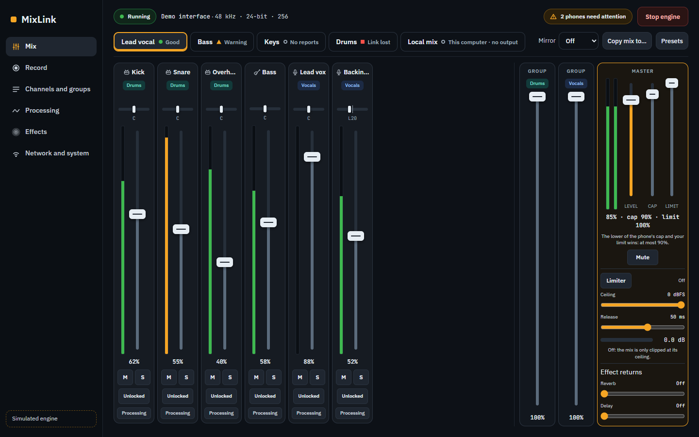
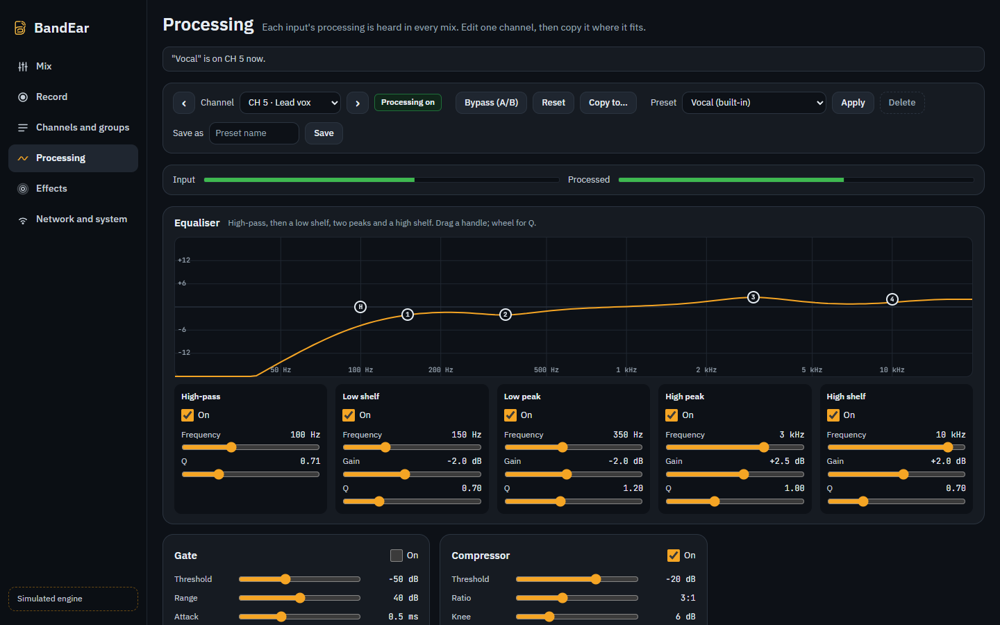
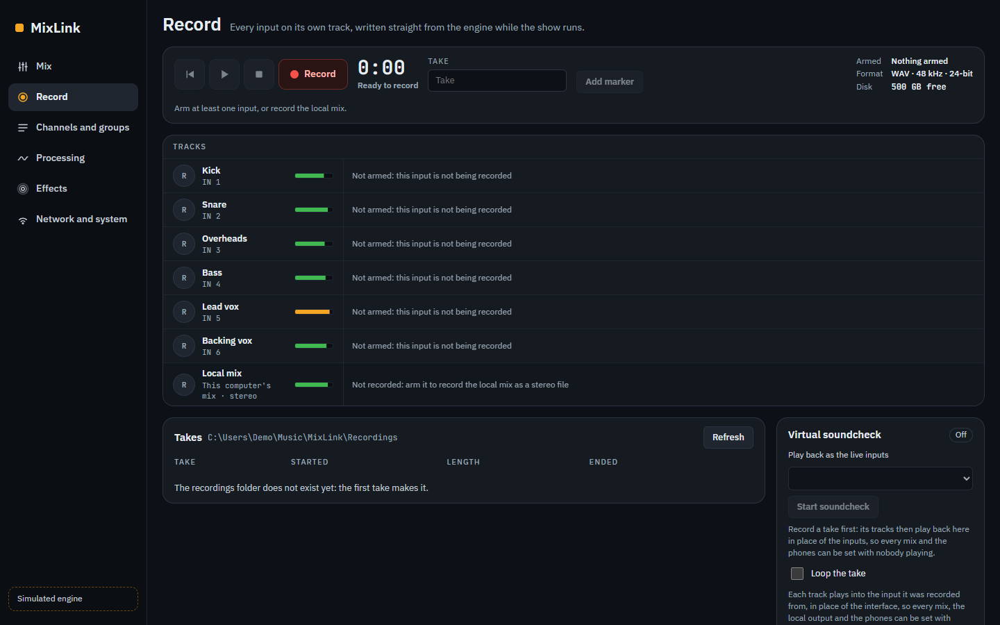
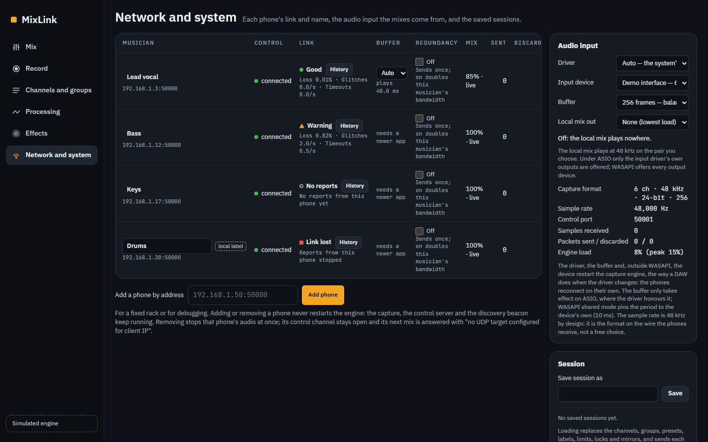
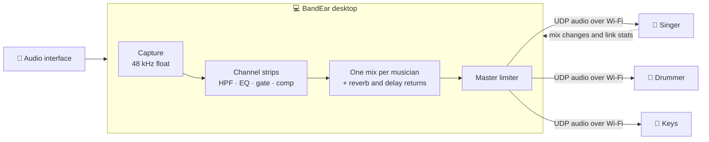

<div align="center">


# BandEar

**Every musician gets their own in-ear mix, on their own phone.**
Low-latency personal monitoring over the Wi-Fi you already have — no extra hardware.

[](https://github.com/carlosescor2199/bandear/releases/latest)
[](https://github.com/carlosescor2199/bandear/releases)
[](LICENSE)
[](https://github.com/sponsors/carlosescor2199)


[**🌐 Website**](https://bandear.com/) · [**Download**](#-download) · [**Quick start**](#-quick-start) · [**Features**](#-features) · [**How it works**](#-how-it-works) · [**Build from source**](#-build-from-source) · [**Support**](#-support-the-project)

<br />



</div>

---

## Why BandEar

On stage and in rehearsal, everyone wants to hear something different: the singer wants more voice, the drummer more bass, the keys player more click. Traditional personal monitor systems solve that with dedicated mixers and wired receivers that cost a lot.

**BandEar turns a computer and the musicians' own phones into a personal monitor system.** Your audio interface feeds the desktop app; each musician opens the BandEar app on their phone, joins the same Wi-Fi, and mixes their own ears — while the engineer keeps full control from the desk.

---

## 📦 Download

Grab the file for your system from the [**latest release**](https://github.com/carlosescor2199/bandear/releases/latest).

| You have | Download | Then |
|---|---|---|
| 🪟 **Windows** 10/11 | `BandEar_<version>_x64-setup.exe` | Run it. First time: *More info → Run anyway* (the installer is not signed yet). |
| 🍎 **macOS**, Apple Silicon (M1–M4) | `BandEar_<version>_aarch64.dmg` | Drag BandEar to Applications. First time: open it once, then *System Settings → Privacy & Security → Open Anyway*. |
| 🍎 **macOS**, Intel | `BandEar_<version>_x64.dmg` | Same as above. |
| 🐧 **Linux** | `BandEar_<version>_amd64.AppImage` or `.deb` | `chmod +x` the AppImage and run it, or install the `.deb`. |
| 🤖 **Android** 10+ (the musicians' app) | `BandEar_<version>_android.apk` | Allow installs from your browser, then open the APK. |

> [!NOTE]
> An iOS app for musicians is on the roadmap.

> [!TIP]
> BandEar used to be called MixLink. The desktop app brings a MixLink desk's sessions, backups and recordings folder over on its first start. On Android, BandEar installs as a new app beside MixLink, so the phone's saved mixes start fresh. Phones and desks of either name still find each other.

---

## 🚀 Quick start

1. **Plug in your audio interface** and open **BandEar** on the computer. Pick the interface in *Network and system → Audio input* and press **Start engine**.
2. **Connect the phones** to the same Wi-Fi as the computer and open the **BandEar** app on each one. They find the desk on their own — no IP addresses to type.
3. **Mix.** Each musician moves their own faders on the phone. From the desk you see every mix, set limits, copy mixes, add processing and record the show.

> [!TIP]
> No interface at hand? Choose the **Demo (no interface)** driver to hear eight generated channels and try everything.

---

## ✨ Features

<table>
<tr>
<td width="50%" valign="top">

### 🎚️ Personal mixes
- One mix per musician, edited from their phone or from the desk
- Up to **32 inputs**, named channels, stereo pairs and groups
- Engineer limits and locks, presets, copy and mirror mixes
- Smooth fader moves — no clicks, no zipper noise
- Saved sessions and automatic mix backups

</td>
<td width="50%" valign="top">

### 🎛️ Processing
- A console-style strip on every input: **high-pass, 4-band EQ, gate and compressor**
- Interactive EQ curve with draggable bands, gain-reduction meters, A/B bypass
- **Limiter** on every musician's master
- Shared **reverb** and **delay** with per-channel sends and per-mix returns
- Built-in and custom strip presets — and **0 ms** of added latency

</td>
</tr>
<tr>
<td width="50%" valign="top">

### ⏺️ Recording
- **Multitrack recording**: every input on its own WAV track (24-bit or 32-bit float)
- Markers, a disk-space estimate and crash-safe files
- **Virtual soundcheck**: play a take back as if the band were playing
- A **local mix** for the computer's own headphones or speakers

</td>
<td width="50%" valign="top">

### 📶 Network you can trust
- **Link health** per musician: loss, glitches, round trip and a 10-minute chart
- Set each phone's **buffer** from the desk — Auto or a fixed value
- **Redundancy**: send each packet twice so Wi-Fi drops don't become dropouts
- Engine load meter, log file and a demo source

</td>
</tr>
</table>

### 📸 A closer look

| Channel processing | Recording |
|---|---|
|  |  |

| Network and system |
|---|
|  |

---

## 🔧 How it works



- **Engine** — written in Rust. Capture runs in a lock-free, allocation-free audio path; every mix is built once per block (5.3 ms at 256 frames) and sent as 16-bit PCM over UDP.
- **Desktop app** — [Tauri](https://tauri.app) with a plain web-components UI (no bundler, no npm dependencies).
- **Phone app** — native Android (Kotlin + Jetpack Compose), with an adaptive jitter buffer and packet reordering.
- **Control** — a WebSocket channel carries mixes, link statistics and settings; phones find the desk through a discovery beacon, and iPhones through its Bonjour announcement (`_bandear._tcp`).

**Performance** — with 32 processed inputs and 16 musicians, the engine uses about **18 % of each block** on average (release build). Processing adds **no latency**: filters and dynamics have no look-ahead, and effects are wet returns.

> [!NOTE]
> Audio quality and latency depend on your Wi-Fi. A dedicated 5 GHz access point close to the stage works best.

---

## 🛠️ Build from source

<details>
<summary><b>Desktop app (Windows, macOS, Linux)</b></summary>

Requirements: [Rust](https://rustup.rs) (stable) and the [Tauri prerequisites](https://tauri.app/start/prerequisites/) for your OS.

```bash
git clone https://github.com/carlosescor2199/bandear.git
cd bandear
cargo run -p bandear-desktop
```

Build an installer with the [Tauri CLI](https://tauri.app/reference/cli/):

```bash
cargo install tauri-cli --version "^2"
cd apps/desktop
cargo tauri build
```

Try the UI without any audio hardware (needs Node 22+):

```bash
node apps/desktop/ui/dev/serve.mjs 5199
# open http://localhost:5199/?fake
```

</details>

<details>
<summary><b>Android app</b></summary>

Requirements: JDK 17+, the Android SDK (API 35) and Gradle.

```bash
gradle -p apps/android :app:assembleDebug
# apps/android/app/build/outputs/apk/debug/app-debug.apk
```

</details>

<details>
<summary><b>Tests</b></summary>

```bash
cargo test -p personal-monitoring        # audio engine
cargo test -p bandear-desktop            # desktop commands
node --test apps/desktop/ui/tests        # desktop UI logic
gradle -p apps/android :app:testDebugUnitTest
```

</details>

Every push of a `v*` tag builds the installers for all platforms with [GitHub Actions](.github/workflows/release.yml).

### Project layout

| Path | What lives there |
|---|---|
| [`apps/server`](apps/server) | The audio engine: capture, processing, mixes, recording and the network |
| [`apps/desktop`](apps/desktop) | The desktop app (Tauri) and its console UI — [more docs](apps/desktop/README.md) |
| [`apps/android`](apps/android) | The musicians' phone app |
| [`vendor/cpal`](vendor/cpal) | A patched copy of [cpal](https://github.com/RustAudio/cpal) that opens one ASIO driver by name |

---

## 🗺️ Roadmap

- [x] Personal mixes, channels, groups and sessions
- [x] Local mix, multitrack recording and virtual soundcheck
- [x] Link health, phone buffer, redundancy and demo source
- [x] Channel processing, limiter, reverb and delay
- [ ] iOS app for musicians
- [ ] Signed installers for Windows and macOS

Ideas and bug reports are welcome in [Issues](https://github.com/carlosescor2199/bandear/issues).

---

## 🤝 Contributing

Contributions are welcome! A good way to start:

1. Open an [issue](https://github.com/carlosescor2199/bandear/issues) to discuss the change.
2. Fork the repo and create a branch.
3. Keep tests green (`cargo test`, `node --test`) and use [Conventional Commits](https://www.conventionalcommits.org).
4. Open a pull request.

---

## 💖 Support the project

BandEar is free and open source, built in spare time. If it helps your band, church, studio or school, you can help keep it going:

<div align="center">

[](https://github.com/sponsors/carlosescor2199)

</div>

Starring the repo ⭐ and sharing it with other musicians helps too.

---

## 📄 License

BandEar is released under the [MIT License](LICENSE).

It includes a modified copy of [cpal](https://github.com/RustAudio/cpal) in [`vendor/cpal`](vendor/cpal), which keeps its own license (Apache-2.0), and is built with [Tauri](https://tauri.app).

<div align="center">
<sub>Made with ❤️ for musicians by <a href="https://github.com/carlosescor2199">Carlos Escudero</a></sub>
</div>
